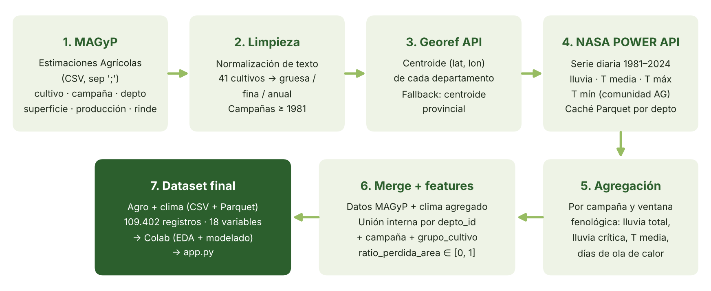
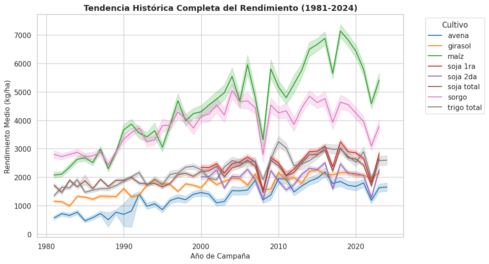
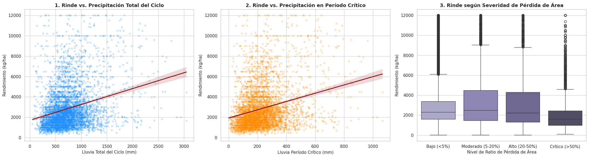

# 🌾 Crop Yield Prediction under Agroclimatic Variability — Argentina

Machine learning pipeline and interactive web app to estimate crop yield (kg/ha) at department level in Argentina, combining official agricultural statistics with 43 years of daily climate data.

[](https://crop-yield-argentina.streamlit.app/)



## The problem

Grain production is Argentina's main source of export revenue, but droughts, heat waves and excess rain cause sharp swings in yields. The 2022/23 drought alone cost the agricultural sector tens of billions of US dollars. Traditional yield estimates rely on field surveys that arrive near harvest, or on historical averages that underestimate losses in extreme years.

**Goal:** estimate the expected yield of a crop in a given region *before* harvest, from the climate conditions of the season.

## Data

No public dataset combined yield and climate by department and season, so I built one:

| Source | What it provides |
|---|---|
| [MAGyP – Estimaciones Agrícolas](https://datos.magyp.gob.ar/dataset/estimaciones-agricolas) | Planted/harvested area, production and yield by crop, season, province and department |
| [NASA POWER API](https://power.larc.nasa.gov/) | Daily precipitation and temperature (1981–2024) for each department |
| [Georef API](https://apis.datos.gob.ar/georef) | Department centroid coordinates |

**Result:** 109,402 records × 18 variables, 41 crops, seasons 1981–2024.

The ETL script ([`src/build_dataset.py`](src/build_dataset.py)):
1. Normalizes crop names and maps 41 crops into three agronomic groups (summer, winter and annual crops).
2. Geolocates each department (with provincial fallback) and downloads its daily climate series, with local Parquet caching.
3. Aggregates climate over each crop group's growing window: total rainfall, rainfall in the critical period (flowering/grain filling), mean temperature and heat-wave days.
4. Joins climate and agricultural data by department + season + crop group, and derives the area-loss ratio.

## Approach

- **EDA:** data-quality audit, distribution analysis, technology trend over time, climate–yield relationships and correlations.
- **Leakage prevention:** variables only known after harvest (production, harvested area) were excluded from the features.
- **Strict temporal split:** trained on seasons ≤ 2018, tested on 2019–2024 — the model is evaluated on *future* seasons it never saw, including the 2022/23 drought.
- **Models compared:** Ridge (linear baseline), Gradient Boosting, Random Forest and a Random Forest tuned with GridSearchCV + TimeSeriesSplit.



## Results (test set: seasons 2019–2024)

| Model | MAE (kg/ha) | RMSE (kg/ha) | R² |
|---|---:|---:|---:|
| Ridge (linear baseline) | 1,184.87 | 1,486.41 | 0.341 |
| Gradient Boosting | 860.63 | 1,087.22 | 0.647 |
| Random Forest | 676.68 | 891.82 | 0.763 |
| **Random Forest (tuned)** | **676.13** | **890.68** | **0.763** |

- The tuned Random Forest **cuts the error by 42.9%** vs. the linear baseline and explains ~76% of yield variance on unseen seasons.
- Yield responds non-linearly to climate, crop and region — exactly what average-based methods fail to capture.
- Rainfall in the critical period is slightly more associated with yield than total season rainfall, and yields drop sharply when more than 50% of the planted area is lost.



## Web app

The Streamlit app ([`app/app.py`](app/app.py)) turns the model into a *what-if* tool for non-technical users: choose a crop, province, department, season and a water scenario (normal, dry or wet year). The app fills in the reference climate automatically from the department's history and returns the estimated yield.

## Limitations & next steps

Being explicit about what this version does **not** do:

- **Trend extrapolation:** tree-based models can't extrapolate the technology trend beyond the last training year. The temporal cross-validation (mean R² −0.23 in early folds) confirms the model depends on recent history. *Next:* model the trend explicitly (detrending + residual model).
- **Area-loss ratio:** it is computed from harvested area, which is only known at the end of the season. In the app it is an explicit user assumption (expected loss %), not an observed value.
- **Spatial resolution:** climate is taken at each department's centroid, and the model works at province level.
- **Scenarios:** dry/wet factors are fixed assumptions, not calibrated from data. *Next:* calibrate with historical percentiles.
- **Planned:** feature importance / SHAP, prediction intervals, XGBoost/LightGBM, satellite indices (NDVI) and ENSO phase.

## Repository structure

```
├── src/build_dataset.py          # ETL: MAGyP + NASA POWER + Georef
├── notebooks/eda_and_modeling.ipynb  # EDA, modeling and evaluation (Spanish)
├── app/app.py                    # Streamlit app
├── data/                         # Raw + processed datasets, source info
├── docs/                         # Technical report and presentation (Spanish)
└── images/                       # Figures used in this README
```

## How to run

```bash
pip install -r requirements.txt
streamlit run app/app.py
```

The notebook was developed in Google Colab; update the dataset path in the loading cell to `data/dataset_agro_clima_con_ratio_perdida.csv` to run it locally.

## Team & my role

Final project for the Higher Technical Degree in Data Science & AI at IFTS N°11 (Buenos Aires, 2026), submitted as a team assignment (Group 8: Gabriel Mollis, Pedro Casa, Mariano Sileo, Andrés Francica).

**My contributions:** I developed the technical work end to end — the data-integration ETL with NASA POWER and Georef, the exploratory analysis, the modeling and evaluation, the Streamlit app, and the technical report.

**Tech stack:** Python · pandas · NumPy · scikit-learn · Matplotlib · Seaborn · Plotly · Streamlit · REST APIs · Parquet

---
👤 **Pedro Casa** — [LinkedIn](https://www.linkedin.com/in/pedroecasa/)
